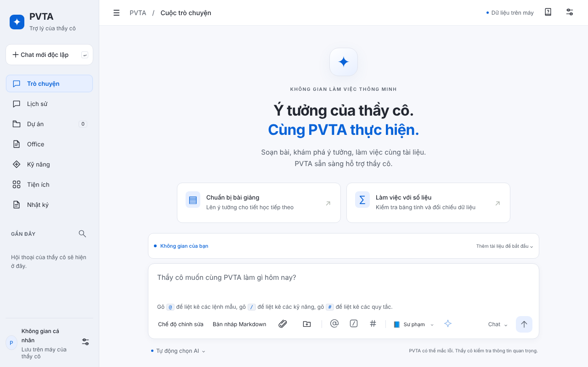
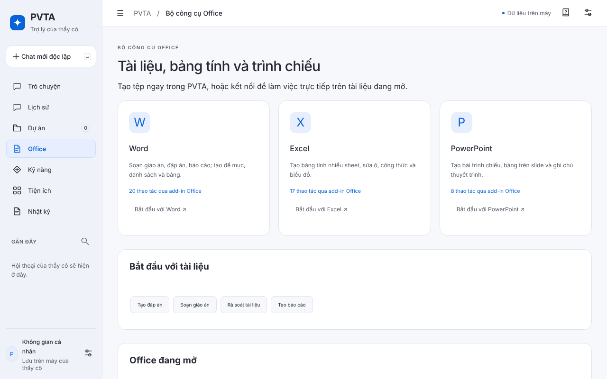
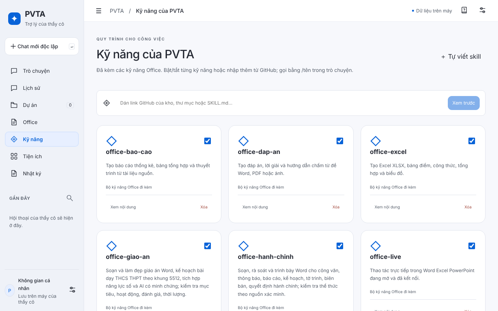
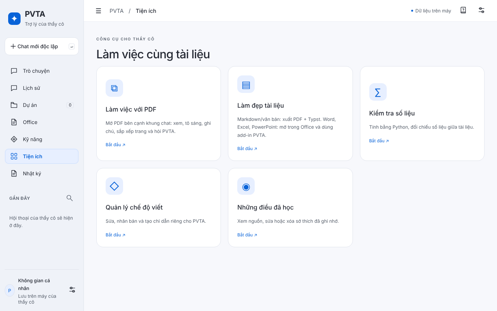
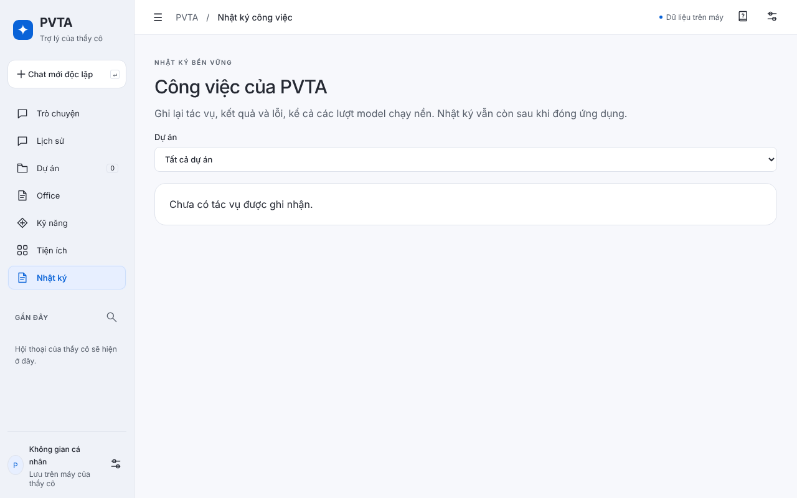
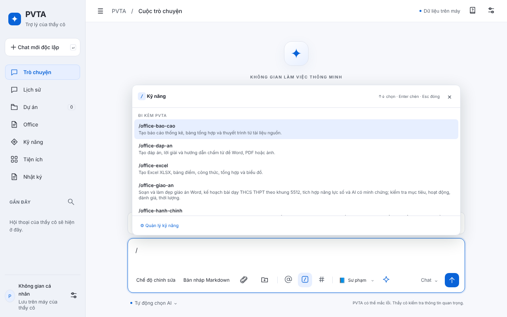
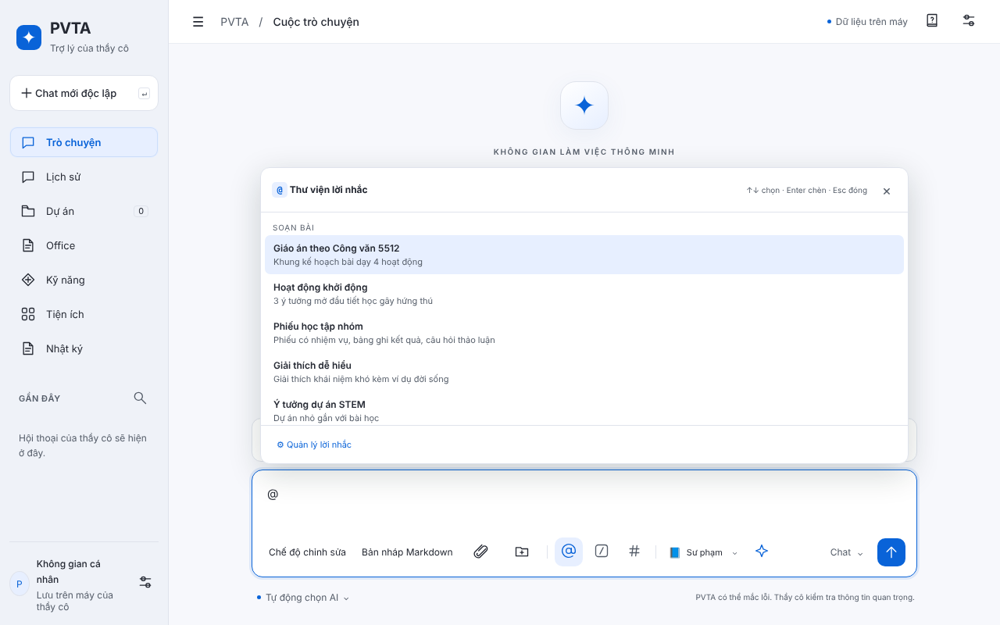
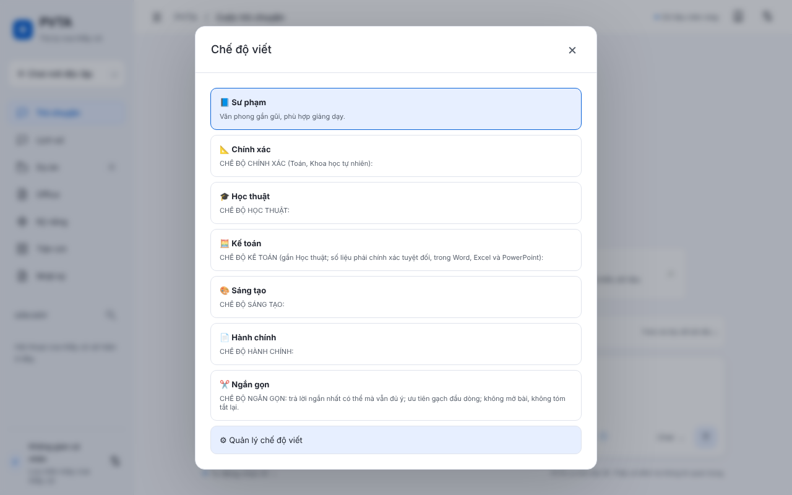
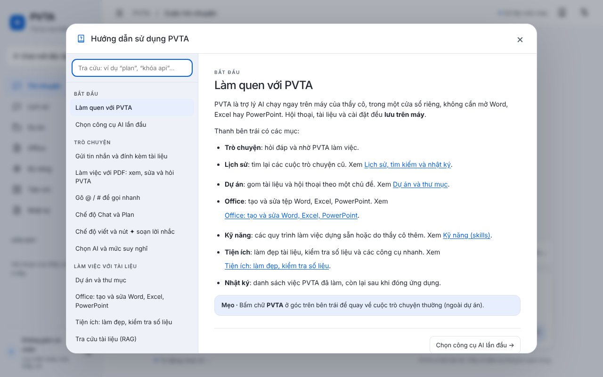
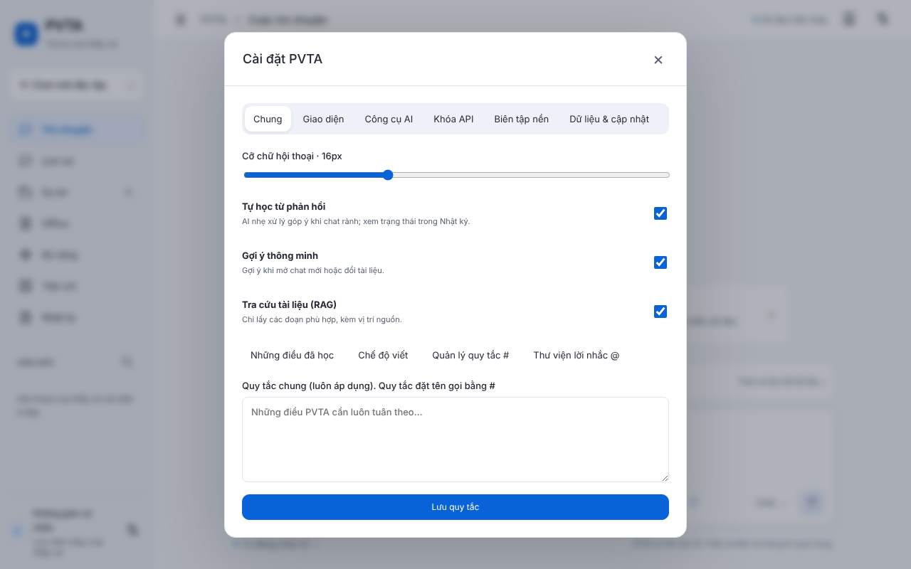

<div align="center">

# PVTA

### Trợ lý AI dành riêng cho giáo viên Việt Nam
**Soạn giáo án, ra đề, tính điểm, làm slide, ngay trong Word, Excel, PowerPoint, hoặc trong một cửa sổ chat riêng.**

[**⬇️ Tải bản cài cho Windows**](https://github.com/phandinhdoc-spec/MySoft/raw/main/Cai-PVTA.bat) &nbsp;•&nbsp; [**⬇️ Tải bản cài cho macOS**](https://github.com/phandinhdoc-spec/MySoft/raw/main/Cai-PVTA.command) &nbsp;•&nbsp; [Tất cả bản phát hành](https://github.com/phandinhdoc-spec/MySoft/releases/latest)

*Cài một lần, có đủ cả hai: **PVTA Chat** và **tiện ích PVTA cho Office**.*

</div>

---

## Vì sao giáo viên chọn PVTA?

Giáo viên không thiếu ý tưởng, chỉ thiếu thời gian. PVTA lo phần việc lặp đi lặp lại để thầy cô giữ sức cho học sinh.

| Việc thầy cô hay làm | PVTA giúp thế nào |
|---|---|
| **Soạn giáo án, phiếu học tập** | Viết nháp theo yêu cầu, sửa trực tiếp trong Word, giữ đúng định dạng |
| **Ra đề, tạo câu hỏi** | Sinh câu hỏi trắc nghiệm và tự luận từ chính đoạn thầy cô đang chọn |
| **Tính điểm, xếp loại** | Đặt công thức, tô màu, lọc, vẽ biểu đồ trong Excel bằng một câu lệnh tiếng Việt |
| **Làm slide ôn tập** | Tạo slide theo bố cục có sẵn, chỉnh phông, màu, vị trí hình |
| **Công thức Toán, Lý, Hóa** | Chèn thành công thức chuẩn của Word (LaTeX, cả phương trình hóa học) |
| **Văn bản hành chính** | Chế độ Hành chính viết theo thể thức văn bản quy định |
| **Làm đẹp tài liệu** | Chọn chủ đề màu và phông theo môn học, **bấm Hoàn tác** nếu chưa ưng (Word) |

## Điểm nổi bật

- 🧩 **Một lần cài, dùng ở hai nơi.** Dùng ngay trong Word, Excel, PowerPoint, hoặc mở PVTA Chat như một ứng dụng chat độc lập.
- 💳 **Dùng gói đăng ký AI sẵn có của thầy cô.** Chạy qua Claude Code, Codex hoặc Antigravity (agy) đã đăng nhập, hoặc nhập khóa API (Anthropic, OpenAI, Google Gemini, Command Code, Ollama và máy chủ tương thích OpenAI).
- 🔒 **Khóa API và dữ liệu nằm trên máy của thầy cô.** Khóa không bao giờ được gửi về giao diện add-in; thầy cô thấy và chấp thuận nội dung trước khi PVTA ghi vào tài liệu.
- ✍️ **Nhiều chế độ viết:** Sư phạm, Chính xác (Toán, KHTN), Học thuật, Sáng tạo, Hành chính, Ngắn gọn. Có thể tự tạo chế độ riêng và chia sẻ trong tổ chuyên môn.
- 📚 **Thư viện 24 lời nhắc mẫu cho giáo viên** (Soạn bài, Kiểm tra – đánh giá, Điểm số, Trình chiếu, Văn bản – hành chính, Học sinh – phụ huynh), gõ `/` là gọi ra.
- ✨ **Tối ưu lời nhắc:** gõ ý thô, PVTA viết lại thành lời nhắc rõ ràng. Chỗ nào thiếu thông tin thì để ô trống chờ thầy cô điền, không tự bịa.
- 🔁 **PVTA tự cập nhật:** có bản mới thì hiện nút *Cập nhật ngay*. Cấu hình, hội thoại và skill của thầy cô được giữ nguyên.
- 🇻🇳 **Giao diện, lời nhắc và quy tắc viết bằng tiếng Việt**, làm cho giáo viên THCS, THPT.

## Làm việc theo Plan trong PVTA Chat

Chọn **Plan** để PVTA khảo sát bối cảnh và hỏi thông tin quan trọng còn thiếu trước khi lập kế hoạch. Sửa trực tiếp trong Plan hoặc mở **Xem quy trình ↗** để xem sơ đồ, đầu vào/đầu ra và quan hệ phụ thuộc. Bấm **Lưu Plan và Quy trình** để đồng bộ; chỉ **Duyệt và chạy** mới bắt đầu thực thi. Thanh thao tác đầu thẻ có nút **Duyệt và chạy** (hoặc **Tiếp tục** nếu đã duyệt) trong cả sơ đồ quy trình và danh sách Plan. Khi đang sửa, cần lưu trước khi chạy; khi đang chạy, bấm **Dừng** tại thanh này.

Mỗi giai đoạn trong danh sách Plan và mỗi nấc trên sơ đồ có nút **Duyệt và chạy** riêng: chỉ chạy bước được chọn rồi dừng chờ duyệt tiếp. Nút bị khóa khi bước cần chờ chưa hoàn tất, đang chạy hoặc còn bản sửa chưa lưu; bước đã xong giữ kết quả và không chạy lại. Với quy trình đa nhánh, các nhánh độc lập được duyệt riêng; nấc hợp nhất chờ đủ các nhánh trước. Quy trình độc lập kiểm tra lại cấu hình và đầu vào trước khi dùng kết quả cũ.

Theo dõi trạng thái, nhật kí và kết quả từng bước. Khi lỗi, chọn thử lại, chấp nhận bỏ qua hoặc dừng; bước thiếu kết quả vẫn bị chặn và có thể bổ sung dữ liệu thay thế. Sau gián đoạn, tìm **Việc còn dở / bị gián đoạn** trong Nhật kí và đối chiếu kết quả thực tế trước khi tiếp tục.

**Những điều đã học** cho xem nguồn, sửa, chấp nhận và bật dùng kiến thức/skill mới. **Biên tập nền → Làm ngay** không đổi lịch định kì; lịch bị lỡ có lựa chọn chạy bù. [Hướng dẫn đầy đủ và giới hạn kiểm chứng](README-addin.md#plan-và-tiếp-tục-công-việc-trong-pvta-chat). Các chức năng này thuộc PVTA Chat; quy trình độc lập cũ vẫn giữ bộ chạy riêng.

### Học hỏi trong dự án

Trong **Quản lí dự án → Học hỏi** (hoặc nút **Học hỏi** trên thẻ dự án), chọn thư mục tham khảo từ những năm trước. Ví dụ: dự án STEM năm nay chứa văn bản, thông số và số liệu mới; Học hỏi chứa báo cáo cũ, mẫu cách viết, quy trình và lưu ý. Nguồn hiện tại và Học hỏi được gắn nhãn riêng trong ngữ cảnh/tra cứu; AI được hướng dẫn hỏi lại khi thiếu dữ kiện hiện tại.

**Rút kinh nghiệm từ tài liệu** tạo bản nháp bằng AI đang chọn. Xem, sửa rồi **Lưu kinh nghiệm** để ghi tệp Markdown riêng trong thư mục Học hỏi và ghi nhớ cho dự án; có thể chọn lại thư mục này trong dự án năm sau. Chỉ mục/ghi chú lưu trên máy, phần nguồn được gửi cho AI khi dùng chức năng. Mỗi lượt nhập tối đa 60 tệp, sâu 8 cấp; ảnh/PDF quét cần có chữ trích xuất. AI báo khi chỉ đọc trích đoạn vì giới hạn độ dài. Đây là nguồn tham khảo, giáo viên vẫn cần kiểm tra dữ kiện và ghi chú đề xuất.

**Đọc lại** cập nhật tài liệu đã đổi hoặc bị xóa; **Bỏ liên kết** gỡ chỉ mục, giữ nguyên tệp và ghi chú đã lưu. Công tắc riêng cho từng dự án ngừng gửi nguồn và kinh nghiệm ở lượt AI tiếp theo; lịch sử đã trao đổi vẫn còn. Học hỏi không trở thành nơi lưu báo cáo mới; thư mục này có thể nằm trong dự án nhưng được loại khỏi lần quét tài liệu hiện tại. Nếu tệp kinh nghiệm đã bị sửa ngoài PVTA, ứng dụng giữ nguyên và báo xung đột khi lưu lại.

## Giao diện PVTA

### Sách hướng dẫn và Hỏi PVTA

Trong **PVTA Chat**, nhấn **F1** hoặc nút **Hướng dẫn sử dụng** để mở sách: mục lục theo nhóm, chương đánh số, trang đọc có lề rộng và nút sang chương trước/sau. Ô tra cứu chấp nhận tiếng Việt có dấu hoặc không dấu.

Nhấp chuột phải tại nút, vùng trống hoặc ô nhập → **Hỏi PVTA về chỗ này**. Popup ghi nhãn giao diện và tọa độ vừa chọn. Bấm **Chỗ này dùng như thế nào?** hoặc nhập tên chức năng cần hỏi; bấm tên nguồn trong câu trả lời để mở đúng chương. **Esc** đóng popup. Menu đối tượng giữ các lệnh riêng; ô nhập có các lệnh soạn thảo cơ bản.

Popup hiện trả lời bằng **trích đoạn hướng dẫn trên máy**, không gọi model AI. Brain hướng dẫn có chỉ mục riêng dùng chung với sách, dựng một lần khi cần; không đọc nội dung chat hoặc giá trị ô nhập. Nếu không tìm thấy căn cứ, popup yêu cầu tên chức năng cụ thể. Phần này thuộc PVTA Chat, chưa thêm vào menu chuột phải của add-in Office.

<p align="center">
  
  <em>Trang chủ PVTA Chat: bốn gợi ý bắt đầu nhanh cho thầy cô, ô nhập có gợi ý lệnh.</em>
</p>

<table>
  <tr>
    <td width="50%"><br><sub><b>Office:</b> tạo và sửa Word, Excel, PowerPoint ngay trong PVTA.</sub></td>
    <td width="50%"><br><sub><b>Kỹ năng:</b> quy trình làm việc sẵn có, bật/tắt từng kỹ năng, hoặc tự viết kỹ năng riêng.</sub></td>
  </tr>
  <tr>
    <td width="50%"><br><sub><b>Tiện ích:</b> làm việc với PDF, làm đẹp tài liệu, kiểm tra số liệu bằng Python.</sub></td>
    <td width="50%"><br><sub><b>Nhật ký:</b> ghi lại mọi tác vụ, kết quả và lỗi, còn lại sau khi đóng ứng dụng.</sub></td>
  </tr>
  <tr>
    <td width="50%"><br><sub><b>Gõ <code>/</code></b> để gọi nhanh một kỹ năng theo tên.</sub></td>
    <td width="50%"><br><sub><b>Gõ <code>@</code></b> để chọn trong thư viện lời nhắc mẫu cho giáo viên.</sub></td>
  </tr>
  <tr>
    <td width="50%"><br><sub><b>Chế độ viết:</b> Sư phạm, Chính xác, Học thuật, Kế toán, Sáng tạo, Hành chính, Ngắn gọn.</sub></td>
    <td width="50%"><br><sub><b>Hướng dẫn sử dụng</b> tích hợp sẵn, tra cứu theo từ khóa, mở bằng phím F1.</sub></td>
  </tr>
  <tr>
    <td colspan="2" align="center"><br><sub><b>Cài đặt:</b> cỡ chữ, gợi ý thông minh, tra cứu tài liệu (RAG), quy tắc chung và thư viện lời nhắc.</sub></td>
  </tr>
</table>

## Cài đặt trong 1 phút

Chỉ cần **một tệp**, đặt ngay ở trang này:

### Windows
1. Tải [**Cai-PVTA.bat**](https://github.com/phandinhdoc-spec/MySoft/raw/main/Cai-PVTA.bat) (chuột phải → *Lưu liên kết thành…*).
2. Bấm đúp. Nếu Windows báo *Windows protected your PC*, chọn **More info → Run anyway**. Khi hỏi về chứng chỉ, chọn **Yes**.
3. Thoát hẳn Word / Excel / PowerPoint rồi mở lại: **Chèn → Phần bổ trợ → PVTA**.

Muốn một tệp `.exe` thông thường: tải `PVTA-Studio-Setup-*.exe` ở [trang Releases](https://github.com/phandinhdoc-spec/MySoft/releases/latest). Một tệp cho cả Windows x64 và ARM64, đã gồm PVTA Chat và tiện ích Office. Mac Apple Silicon: tải `PVTA-Studio-*-arm64.dmg`.

### macOS
Cài mới hoặc cập nhật đều chạy cùng lệnh:

```bash
curl -fsSL https://raw.githubusercontent.com/phandinhdoc-spec/MySoft/main/installers/studio.sh | bash
```

PVTA tải mã nguồn rồi biên dịch Chat và Office trên máy. Lần đầu cần Command Line Tools của Apple; nếu script mở yêu cầu cài, hoàn tất rồi chạy lại. Node/Rust được chuẩn bị nếu thiếu. Bản cũ chỉ đóng sau khi dựng thành công; dữ liệu được giữ nguyên. Office có thể hỏi quyền tin cậy chứng chỉ cục bộ lần đầu. Không cần tải DMG để cập nhật.

Chi tiết và giới hạn kiểm chứng: [Cài và cập nhật](docs/installation.md).

### Cần chuẩn bị gì?
Máy cần **ít nhất một** trong các thứ sau: `claude` (Claude Code), `codex` (OpenAI Codex), `agy` (Antigravity) đã đăng nhập, **hoặc** một khóa API nhập trong ⚙ Cài đặt của PVTA. Giáo viên ở Việt Nam thường chọn `agy` với gói Google AI. Chưa có công cụ nào thì cửa sổ cài đặt sẽ hướng dẫn từng bước.

### Gỡ cài đặt
- **Windows:** đặt `PVTA_UNINSTALL=1` rồi chạy lại `Cai-PVTA.bat`. PVTA Chat gỡ trong *Cài đặt → Ứng dụng*.
- **macOS:** `bash Cai-PVTA.command --uninstall`, rồi kéo `PVTA.app` vào Thùng rác.

## Tình trạng hiện tại

- **PVTA Chat** có gói cho **macOS (Apple Silicon và Intel), Windows (x64 và ARM64) và Linux** (Windows và macOS qua gói Studio `.exe`/`.dmg`; Linux qua `.AppImage`). **Tiện ích Office** chạy trên Windows và macOS.
- Bản Windows còn mới, **chưa được thử rộng**; nếu gặp lỗi, thầy cô báo ở [Issues](https://github.com/phandinhdoc-spec/MySoft/issues).
- Các tệp cài **chưa được ký số**, nên Windows và macOS có thể hiện cảnh báo ở lần đầu. Đó là bình thường với phần mềm chưa mua chứng chỉ.

## Dành cho người phát triển

```
shared/          Kiểu giao thức, bộ tách khối office-tool, danh mục công cụ
core/            Lõi dùng chung: engine, backend AI, dự án, skill, RAG
bridge/          Tiến trình cục bộ cho add-in (WebSocket)
addin/           Office add-in (React + Office.js)
chatbox/         Ứng dụng PVTA Chat (Tauri)
skills/          Skill nền: pvta-word, pvta-excel, pvta-powerpoint, pvta-gioi-thieu
installers/      Mã nguồn các bộ cài (macOS, Windows)
scripts/         Dựng bộ cài: build-single-installer.sh, build-studio-dmg.sh, windows/studio.iss
```

```bash
npm install
npm test
npm run typecheck
bash scripts/build-single-installer.sh   # dựng Cai-PVTA.bat và Cai-PVTA.command vào release/
```

Phát hành: workflow **PVTA Studio exe va dmg** dựng `.exe` và `.dmg`; workflow **PVTA Chatbox desktop** dựng gói PVTA Chat cho từng hệ điều hành. Tài liệu chi tiết: [pvta-chatbox.md](pvta-chatbox.md), [README-addin.md](README-addin.md).

---

<div align="center">

**PVTA** · do thầy Phan Anh (THCS Phan Văn Trị) phát triển, TP. Hồ Chí Minh
Nếu PVTA giúp thầy cô tiết kiệm thời gian, hãy ⭐ **Star** repo và chia sẻ cho đồng nghiệp nhé!

</div>


### Làm đẹp bằng Typst

Yêu cầu “Làm đẹp tài liệu” với Word, Excel hoặc PowerPoint được hướng dẫn mở tệp trong Office và dùng add-in PVTA đi kèm; ChatBox không chạy sửa bản sao hay xuất Typst thay thế. Với Markdown/văn bản, desktop đề xuất xuất Typst thay vì áp theme Office. Đầu ra là **một ZIP gồm `document.pdf`, `document.typ`, ảnh xem trước và hướng dẫn**. PDF để xem/in; chỉnh mã `.typ` rồi biên dịch lại để thay đổi nội dung và bố cục. XLSX gốc vẫn cần giữ nếu muốn tính toán.

Ứng dụng đọc mẫu `.typ`, `.md` hoặc phần văn bản trích xuất từ tài liệu đính kèm để xây dựng quy tắc lề, phân cấp chữ, khoảng cách, bảng và màu nhấn. Quy tắc nằm ở `core/src/desktop/typst.ts`. Không tự nhận là đã tham khảo mẫu khi chưa đọc; không có thư viện mẫu bên ngoài được tải sẵn trong bản này. Chức năng tạo/sửa Office khác vẫn giữ nguyên; riêng làm đẹp Office dùng add-in.

Bộ biên dịch Python `typst==0.15.0` tự chuẩn bị khi xuất lần đầu (cần Internet), hoặc qua Chuẩn bị công cụ. Tệp chỉ được tạo sau khi duyệt. Biên dịch lỗi không công bố gói kết quả; tên trùng không bị ghi đè. Mã được biên dịch trong thư mục riêng, giới hạn 120 giây cho worker.

Giới hạn bản đầu: mã Typst phải tự chứa, chưa hỗ trợ import/package/tài nguyên ngoài; chưa chuyển ảnh nhúng, biểu đồ, Equation và công thức bảng tính phức tạp một cách đầy đủ. Ứng dụng phải báo thiếu dữ liệu thay vì âm thầm bỏ nội dung. Ảnh xem trước được đóng gói để người dùng soát bố cục; chưa có vòng AI tự xem ảnh và sửa sau biên dịch. Không tuyên bố PDF là tài liệu chỉnh sửa như Word.

Kiểm tra: `python3 -m unittest discover -s core/python -p test_typesetting.py` (cần `typst==0.15.0`), `npm run typecheck`, `npx vitest run core/test/desktop.test.ts bridge/test/beautify.test.ts`.

### Cài công cụ AI từ Cài đặt

Trong **Cài đặt → Công cụ AI**, mỗi công cụ (Claude Code, OpenAI Codex, Google Antigravity `agy`) có **một nút**: PVTA kiểm tra máy đã có công cụ chưa; chưa có thì tải script cài nguyên gốc vào thư mục `installers` trong dữ liệu ứng dụng và chạy **ở nền** (khung tiến trình hiện ngay trong thẻ, không mở Terminal), rồi tiếp tục đăng nhập. Khi chưa phát hiện công cụ/API nào, Cài đặt mở thẳng thẻ này. Không yêu cầu npm có sẵn.

Đăng nhập cũng nằm trong thẻ: với **Claude Code** (`claude auth login`) và **Codex** (`codex login`, hoặc `codex login --device-auth` khi trình duyệt không mở được), PVTA chạy lệnh ở nền, mở trang đăng nhập của nhà cung cấp và hiện ô để dán mã nếu công cụ hỏi. Thông tin đăng nhập do chính công cụ lưu, PVTA không giữ mật khẩu hay token; PVTA chỉ mở đường dẫn HTTPS thuộc đúng miền nhà cung cấp. **agy** chưa có lệnh đăng nhập không cần giao diện dòng lệnh, nên PVTA mở một cửa sổ Terminal cho riêng bước đăng nhập và tự nhận khi xong (`agy auth status`). Nếu cài ẩn hoặc đăng nhập không thành công, nút **Mở bằng Terminal** chạy theo cách cũ.

Gói cần có (theo tài liệu nhà cung cấp, kiểm tra 10/2026): Claude Code cần gói Pro, Max, Team hoặc Enterprise (gói Claude miễn phí không dùng được); Codex dùng được với cả gói ChatGPT Free nhưng hạn mức thấp; Antigravity có hạn mức miễn phí theo tuần khá thấp và quyền dùng còn tùy tài khoản Google.

Nguồn: `https://claude.ai/install.sh`, `https://chatgpt.com/codex/install.sh`, `https://antigravity.google/cli/install.sh`; Windows dùng `install.ps1`. Ứng dụng chỉ nhận HTTPS từ các miền nhà cung cấp đã khai báo, kiểm tra từng chuyển hướng, giới hạn kích thước/thời gian tải và từ chối phản hồi HTML. `source.json` ghi nguồn và SHA-256 của bytes đã tải để tra cứu; đây không phải xác minh chữ ký nhà phát hành.

Sau khi cài xong, bấm **Kiểm tra lại công cụ AI**, rồi **Đăng nhập…**. Mở trình cài không được coi là cài thành công. Nếu công cụ chưa được phát hiện, mở lại PVTA. CommandCode và các kết nối API không cần tải ứng dụng riêng. Các công cụ này là CLI phục vụ PVTA, không phải ứng dụng chat Claude/ChatGPT.

Kiểm thử tải/cấu hình bộ cài: `npx vitest run core/test/backend-install.test.ts core/test/desktop.test.ts`. Các bài kiểm thử giả lập mạng và không thực thi bộ cài trên máy kiểm thử.

### Đầu vào quy trình tự động

Bấm **Tự tạo quy trình** để mở hội thoại thiết kế riêng. Thanh **Đầu ra của quy trình** luôn nằm phía trên ô soạn, với nút **Làm ngay** bên phải. Mô tả sản phẩm mong muốn rồi trao đổi với PVTA để làm rõ tiêu chí, nhận góp ý và phản biện. Nhắn “Làm ngay”, “làm đi”, “đồng ý tạo” hoặc bấm **Làm ngay** để tạo và lưu các bước; nội dung đang gõ cũng được gửi khi bấm nút. Nút **Xem quy trình** mở bản đã tạo để chỉnh sửa hoặc chạy. Việc tạo không tự chạy quy trình và không yêu cầu thêm đầu vào. Trạng thái thiết kế được lưu theo hội thoại; nếu AI trả sai định dạng hoặc bị dừng, không lưu quy trình dở dang và có thể thử lại.

Trong **Quy trình**, chọn đầu vào là **Thư mục**, **Một tệp**, **Nội dung chat của người dùng** hoặc **Prompt mẫu**. Có thể chỉ dùng prompt của từng bước mà không chọn đầu vào riêng. Nội dung chat có thể nhập trực tiếp hoặc lấy các tin nhắn của người dùng trong một hội thoại; prompt mẫu có thể lấy từ thư viện rồi chỉnh sửa. Nội dung đã chọn được lưu cùng quy trình, không tự thay đổi theo hội thoại gốc.

Đầu vào được gửi tới từng bước; dùng `{{input}}` để đặt đầu vào tại vị trí cụ thể và `{{prev}}` để chèn kết quả bước trước. Tệp hỗ trợ văn bản, Markdown, Typst, CSV, PDF có chữ và Office (DOCX/XLSX/PPTX); đầu vào chung của quy trình chưa đọc ảnh (ảnh đính kèm riêng cho từng nút thì có, xem bên dưới). Nội dung đầu vào tối đa 60.000 ký tự; vượt giới hạn sẽ báo lỗi thay vì âm thầm cắt bớt.

#### Tài nguyên riêng của từng nút

Trong hộp **Sửa bước**, ô Prompt giống ô chat nhưng chỉ có 5 công cụ: **chèn tệp/ảnh**, **chèn thư mục**, **@ prompt mẫu**, **/ skill** và **# quy tắc**. Khi nút chạy:

- **Tệp** được đọc nội dung, tối đa 20.000 ký tự mỗi tệp và 60.000 ký tự mỗi nút.
- **Thư mục** được đọc tối đa 40 tệp được hỗ trợ, bỏ qua tệp ẩn.
- **Ảnh** được gửi kèm để AI xem trực tiếp, tối đa 10 ảnh.
- **Skill** gọi bằng `/tên` và **quy tắc** gọi bằng `#khóa` được nạp cho nút (quy tắc cá nhân và của dự án chứa quy trình). Quy tắc "Luôn áp dụng" chưa tự áp vào nút.
- Thiếu tệp thì quy trình dừng và báo rõ nút và tệp nào.
- Nút sinh từ Plan bị khóa chèn tệp, vì lưu Plan sẽ dựng lại nút và làm mất tệp.

Không bắt buộc chọn thư mục để xử lý tệp, chat hoặc prompt ở chế độ chỉ đọc. Nếu một bước cần **Chỉnh sửa**, chọn thêm **Thư mục để sửa tệp**; thư mục đầu vào cũng có thể dùng làm thư mục làm việc.


### Quy trình đa nhánh và chạy song song

Trong **Quy trình → Cách chạy**, chọn **Tuần tự** hoặc **Đa nhánh**. Quy trình cũ vẫn chạy tuần tự. Khi chuyển sang đa nhánh, các bước ban đầu vẫn chờ bước đứng trước; bấm từng thẻ và thay đổi **Các bước cần chờ** để tách nhánh.

- Không chọn bước cần chờ: nhánh độc lập, có thể chạy song song.
- Chọn nhiều bước cần chờ: bước hợp nhất chờ tất cả kết thúc; `{{prev}}` nhận kết quả kèm tên từng bước theo thứ tự chọn, không theo thứ tự hoàn tất. `{{input}}` vẫn là đầu vào chung. Mỗi kết quả lưu tối đa 20.000 ký tự.
- **Số bước chạy đồng thời**: mặc định 2, chọn từ 1 đến 4 cho mỗi quy trình. Bước có quyền **Chỉnh sửa** chạy độc quyền giữa các quy trình; các bước chỉ đọc có thể chạy đồng thời. Khóa không bao gồm chat, người dùng hay ứng dụng ngoài.
- **Nhiều quy trình độc lập** có thể chạy cùng lúc, mỗi quy trình một lượt; không chạy trùng cùng một quy trình. Khi một quy trình đang chạy, chỉ sửa, ghim, xóa hoặc chạy lại chính quy trình đó bị khóa; quy trình khác vẫn thao tác được. Mã đã đọc không đặt giới hạn số quy trình chạy cùng lúc; chưa đo tải thực.
- Một nhánh lỗi không dừng nhánh độc lập. Bước phụ thuộc bị bỏ qua và ghi lý do, trừ khi bước lỗi bật **Lỗi vẫn chạy tiếp**. Toàn bộ lần chạy vẫn báo lỗi nếu có bước lỗi.
- **Dừng** hủy lượt chạy của quy trình đang chọn, gồm cả việc viết lại prompt của quy trình đó nếu đang diễn ra; các quy trình khác không bị ảnh hưởng. **Chạy lại phần lỗi** giữ kết quả thành công chỉ khi toàn bộ chuỗi phụ thuộc đã thành công, rồi chạy lại phần còn lại. Cấu hình và nội dung đầu vào phải giống lần trước; nếu đã đổi, bấm **Chạy** từ đầu. Thư mục và tệp đầu ra có thể bị thay đổi bên ngoài mà không được phát hiện: kiểm tra trước khi chạy lại. Không tự hoàn tác thao tác ghi tệp.

Ví dụ tuần tự: Phân tích bài → Soạn câu hỏi → Rà soát. Ví dụ song song: Câu hỏi và Phiếu học tập không chờ nhau → Tổng hợp chờ cả hai. Ví dụ kết hợp: Phân tích bài → hai nhánh Câu hỏi/Phiếu học tập cùng chờ Phân tích → Tổng hợp chờ cả hai nhánh.

**Tự tạo quy trình** có thể đề xuất nhánh độc lập và điểm hợp nhất. Kiểm tra các quan hệ chờ trước khi chạy; hệ thống từ chối vòng lặp, tự chờ và tham chiếu đến bước không tồn tại. Sơ đồ cho phép di chuyển nút, chỉnh đường nối vuông góc và vị trí đầu nối. Xem thêm **Hướng dẫn → Quy trình đa nhánh** trong ứng dụng.

Chạy song song chủ yếu tận dụng thời gian chờ AI; tốc độ không tỷ lệ trực tiếp với số nhân CPU. Nếu RAM thấp hoặc nhà cung cấp báo quá nhiều yêu cầu, giảm số bước đồng thời. Chưa kiểm thử đồng thời với tài khoản AI thật trên mọi backend.

**Cờ việc gấp** (biểu tượng cờ ngay trên nút Não bộ; trong CLI là `/gap`, `/gap on`, `/gap off`):
- **Cờ xanh** (mặc định): Quy trình chạy đúng số bước đồng thời đã đặt (1–4).
- **Cờ đỏ**: bỏ qua số đã đặt; số bước song song tính theo nhân CPU và RAM, tối đa 8. Tạm hoãn Não bộ rút kinh nghiệm khi Quy trình đang chạy. Tự về cờ xanh khi các quy trình chạy xong hoặc sau 30 phút. Nhà cung cấp báo quá nhiều yêu cầu (429) thì giảm một nửa trong 5 phút.
- **Phanh RAM**: trước mỗi lần mở bước mới, PVTA đọc áp lực bộ nhớ (macOS: chỉ số Memory Pressure của Activity Monitor; hệ khác: tỉ lệ RAM trống). Từ mức vàng trở lên thì chỉ chạy 1 bước, ở cả hai màu cờ; bước đang chạy không bị dừng.
- Cờ chỉ đổi màu, không lưu qua lần mở lại ứng dụng, áp dụng chung cho mọi cửa sổ và CLI. GPU gần như không được dùng vì AI chạy ở máy chủ nhà cung cấp. Plan vẫn chạy lần lượt.

### Chèn quy trình mẫu, khung, biến và hàm

**Chèn quy trình mẫu** (thay cho “Áp dụng quy trình mẫu”): thêm cả khối bước của mẫu vào cuối Plan hoặc quy trình đang mở. Không ghi đè hay đổi bước cũ; mỗi bước chèn nhận mã mới và giữ phụ thuộc bên trong khối. Khối chèn là bản sao, sửa prompt, model, quyền thoải mái mà không đổi mẫu gốc. Bước chèn có model **Tự động**, quyền **Chỉ đọc**, và khung của khối đổi màu cam cho tới khi bạn lưu. PVTA gợi ý liên kết **nét đứt** (bước cuối của phần cũ → bước đầu của khối mới); nét đứt chưa có hiệu lực khi chạy, bấm ✓ để thành phụ thuộc thật hoặc ✕ để bỏ. Gợi ý hiện do PVTA tính theo cấu trúc, chưa nhờ AI.

**Số thứ tự nút** hiện ở góc mỗi nút (đánh lại khi thêm/xóa). **Khung** bọc một hay nhiều nút: bấm **Vẽ khung** rồi kéo vùng bao trọn các nút, hoặc nhập số thứ tự (`1,3,5-9`) rồi **Bọc theo số**. Khung lưu mã nút nên đổi số không làm hỏng khung. Khung lồng nhau tối đa 3 tầng; hai khung chồng một phần bị từ chối. Một quy trình cũng có thể là một nút của quy trình khác (`subWorkflowId`, chặn vòng tham chiếu, tối đa 3 tầng); khi chạy, nút này được trải phẳng vào quy trình cha. Giao diện chọn quy trình con làm nút hiện **chưa có**; dữ liệu và việc chạy đã có.

**Biến và hàm trong prompt**: quy trình độc lập hỗ trợ `!bien so-lan = 0`, `!gan so-lan = $so-lan + 1`, `!ham`, `!goi`, `!dau-vao`, `!dau-ra`, `!in`, `!lap-lai`, `!dung`. Bộ chạy giữ trạng thái thật, khởi tạo một lần; không nhờ AI tự đếm. Khai báo ngoài khung thuộc toàn quy trình, trong khung chỉ dùng ở khung đó và khung con. Hàm dùng biểu thức thuần cần duyệt trước khi gọi. `{{input}}` và `{{prev}}` giữ nguyên. Ô prompt có gợi ý và popup xem trước; khai báo cũ được giữ để tương thích. [Cú pháp, ví dụ đếm đến 3 và giới hạn](docs/workflow-language.md).

**Chạy mã**: sinh mã → **AI phản biện** và quét tĩnh (xóa tệp, đường dẫn tuyệt đối, `..`, gọi mạng, lệnh hệ thống) → thẻ **Duyệt mã** → chạy. AI phản biện chỉ cảnh báo, không tự duyệt; mỗi lượt chạy xin duyệt riêng. Cảnh báo mức Cao mặc định chặn, phải chọn **Vẫn chạy**. Bắt buộc chọn **thư mục đầu ra**; mỗi lượt chạy tạo một thư mục con ở đó, chép vào mọi tệp và thư mục đính kèm (cùng đầu vào dạng tệp/thư mục), không giới hạn dung lượng, rồi chạy tại thư mục con. Bản gốc không bị sửa. Giới hạn thời gian mỗi lần chạy mã mặc định 30 phút. Nút ở chế độ **Chỉ đọc** chỉ sinh mã và phản biện, không chạy. **Lưu ý:** thư mục con chỉ là nơi làm việc, không phải hộp cách ly; mã chạy với quyền của tài khoản trên máy. PVTA không tự cài trình thông dịch; thiếu thì báo rõ.

### Plan liên kết Quy trình, tiếp tục công việc và tự học

Xem [hướng dẫn Plan, khôi phục và học nền](README-addin.md#plan-và-tiếp-tục-công-việc-trong-pvta-chat) hoặc **Hướng dẫn → Chế độ Chat và Plan** trong ứng dụng. Plan có bước Bị chặn khi thiếu kết quả, đối chiếu trước khôi phục và duyệt kiến thức trước khi dùng; không áp dụng cách bỏ qua lỗi của quy trình độc lập ở trên.

### Công cụ quản lí quy trình

Khi bấm **Chạy**, **Chạy lại phần lỗi** hoặc chạy một nấc, PVTA viết lại prompt thành YAML có đầu vào và đầu ra để thầy cô xem trước. Không cần khai báo đầu vào/đầu ra ở mọi nút: kết quả bước trước vẫn được chuyển theo liên kết hiện có. Chạy từ chat và cửa sổ quy trình riêng cũng qua bước duyệt này.

Khung xem trước chia không gian với vùng làm việc. Khi cửa sổ hẹp, dùng **Xem vùng làm việc / Xem bản viết lại** để chuyển màn hình. **Sửa lại** cho phép chỉnh bốn mục mô tả; yêu cầu gốc, placeholder, liên kết và tệp được giữ nguyên. **Duyệt và chạy ngay** chỉ dùng bản đã duyệt cho lượt chạy đó. Muốn giữ bản tốt, bấm **Lưu vào bản sao**: PVTA chỉ ghi vào các nút bản sao rồi dừng, chưa chạy. Nếu bản nháp đã cũ so với quy trình hoặc phiên bản Plan thì chưa lưu, và bản nháp được giữ trên khung để đối chiếu. Nút chèn từ mẫu giữ dấu bản sao qua lưu/tải và không sửa mẫu gốc; bản sao trong Plan vẫn theo giới hạn prompt của Plan (4.000 ký tự khi lưu).

Nút gốc của Plan giữ prompt đã duyệt; quy trình dùng ngôn ngữ biến/hàm hoặc khai báo trong khung bỏ qua viết lại. Bản nháp hết hiệu lực nếu định nghĩa quy trình, tài nguyên hoặc ngữ cảnh đổi; lỗi viết lại không tự chuyển sang chạy. Chạy lại dùng prompt đã duyệt còn phù hợp và chỉ tái sử dụng kết quả khi dấu vân tay của nút và các bước phụ thuộc khớp. Bấm **Đóng xem trước** khi đang viết lại thì không chạy và không ghi gì. Nếu tệp đính kèm đã mất, PVTA dừng trước khi gọi model và nêu rõ nút, tệp. Sau **Lưu vào bản sao**, quy trình vẫn chưa chạy; lần Chạy sau mở lại khung duyệt với bản đã lưu, không gọi model viết lại. Chỉ tính năng PVTA Chat desktop có bước này; add-in Office không có.

Trong **Quy trình**, tìm theo tên quy trình hoặc tên bước (hỗ trợ từ khóa không dấu), lọc theo trạng thái lần chạy mới nhất hoặc quy trình đã ghim, sắp xếp theo tên hay thời điểm cập nhật. Quy trình đã ghim luôn ở đầu; bấm **Lưu thay đổi** để lưu trạng thái ghim.

- **Mở đoạn chat** trong menu chuột phải của quy trình mở cửa sổ chat chứa Plan liên kết hoặc hội thoại tạo quy trình. Quy trình vẫn có thể tồn tại độc lập; nếu chưa có hội thoại, chỉ khi chọn lệnh này mới tạo chat mới và lưu liên kết để mở lại lần sau.
- **Nhân bản** tạo mã quy trình và mã bước mới, giữ kết nối phụ thuộc, không mang theo lịch sử hoặc liên kết Plan.
- **Xuất / lưu mẫu** tải JSON hoặc sao chép JSON để tái sử dụng; **Nhập mẫu JSON** nhận tệp hoặc nội dung dán vào và tạo quy trình mới. Mẫu không chứa thư mục, đầu vào, đường dẫn tệp của nút hay lịch sử. Prompt vẫn có thể chứa thông tin riêng, cần kiểm tra trước khi chia sẻ. Khi nhập, quyền chuyển về Chỉ đọc và model về Tự động; kiểm tra lại trước khi chạy.
- **Hoàn tác**, **Làm lại** giữ tối đa 50 trạng thái chỉnh sửa trong lượt mở hiện tại; **Bỏ thay đổi** khôi phục bản đã lưu. Đổi quy trình khi chưa lưu sẽ có xác nhận.
- Tiến độ hiển thị số bước hoàn tất, lỗi và chờ. Mở lịch sử để xem lí do chờ, nhật kí, kết quả và tệp đầu ra. Đầu vào hiển thị ở đây là đầu vào đang lưu, không phải ảnh chụp đầu vào của lần chạy cũ.
- Trước khi chạy lại phần lỗi có bước Chỉnh sửa, cần đối chiếu tệp vì bước bị ngắt có thể đã tác động lên tệp. Quy trình liên kết Plan tiếp tục được chỉnh qua thẻ Plan; nút quay lại mở danh sách quản lí.
# MySoft
# MySoft
